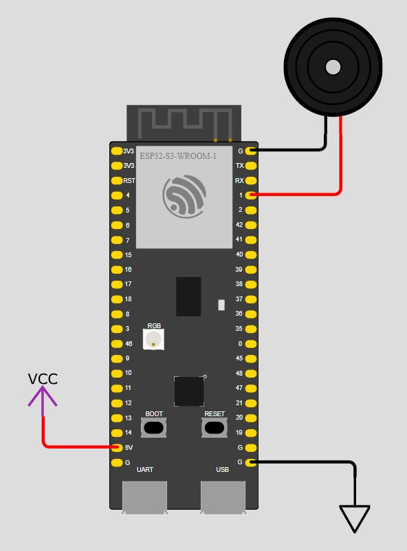

<!-- Comentado para que no aparezca al inicio del texto, github no lo interpreta aún sin comentar

--> Para ver todo con la fuente igual, usar otra herramienta para visualizar y descomentar esto
# Sistema Embebido de detección de somnolencia al volante mediante Visión por Computadora y TinyML sobre ESP32-S3 CAM

---

## 1. Objetivos

### Objetivo General

Desarrollar un sistema embebido de visión por computadora, no invasivo y de bajo costo, capaz de detectar somnolencia en conductores, ejecutando localmente un modelo de aprendizaje profundo cuantizado (MobileNetV2 96×96, α = 0.35) sobre un microcontrolador ESP32-S3 con cámara OV2640, para emitir una alerta sonora oportuna sin depender de conectividad a la nube.

### Objetivos Específicos

1. **Procesamiento y preparación del dataset:** Construir y preprocesar un conjunto de 4,000 imágenes balanceadas en las clases `drowsy` y `non_drowsy`, aplicando redimensionamiento a 96×96 píxeles, conversión a escala de grises, y dividiéndolo en 80% para entrenamiento (3,200 imágenes) y 20% para prueba (800 imágenes).
2. **Entrenamiento y optimización del modelo TinyML:** Entrenar un clasificador mediante *Transfer Learning* con MobileNetV2 96×96 (α = 0.35) en Edge Impulse (25 épocas, tasa de aprendizaje de 0.005), optimizarlo con cuantización `int8` y el compilador EON, de modo que se ajuste a las restricciones de memoria del ESP32-S3.
3. **Validación y despliegue en hardware embebido:** Evaluar el desempeño del modelo con datos no vistos, validar su funcionamiento en vivo (WebAssembly mediante cámara web o móvil) y desplegarlo en el ESP32-S3 CAM, verificando que el consumo de recursos y la latencia de inferencia (~1.5 s por imagen) sean compatibles con la duración temporal de un microsueño.

---

## 2. Planteamiento del problema

### Los microsueños como causa de accidentes viales

La somnolencia al volante es una de las principales causas de accidentes de tránsito graves [1], [2], a diferencia de otras causas, como el exceso de velocidad o el consumo de alcohol, la fatiga deteriora de manera progresiva la atención, el tiempo de reacción y la capacidad de juicio del conductor, sin que este siempre sea consciente de su propio estado [3].

El episodio más crítico es el **microsueño**: una pérdida involuntaria de conciencia de breve duración, durante la cual los párpados se cierran o la cabeza cabecea [3]. En el contexto de este proyecto, se considera que estos eventos duran entre **1.5 y 3 segundos**; a 100km/h, un vehículo recorre alrededor de 28m/s, por lo que un microsueño de apenas 2 segundos equivale a conducir más de 50 metros sin control efectivo, distancia suficiente para abandonar el carril, invadir el carril contrario o colisionar con otro vehículo. Estas situaciones son especialmente frecuentes en conductores de transporte de carga y pasajeros, en turnos nocturnos, en trayectos largos y monótonos, y en personas con privación de sueño [4], lo que convierte la detección temprana de fatiga en un problema de seguridad vial de alto impacto.

### Monitoreo activo no invasivo frente a métodos pasivos tradicionales

Los enfoques tradicionales para mitigar la fatiga son en su mayoría **pasivos**: campañas de concientización, regulación de horas de conducción, descansos obligatorios y confianza en la autoevaluación del conductor. Su limitación principal es que no actúan en el momento crítico y dependen de la voluntad y la percepción subjetiva del conductor.

Frente a ello, los **sistemas de monitoreo activo** analizan en tiempo real señales del conductor o de la conducción. Pueden dividirse en [5], [6]:

**Tabla 1.** Comparación de enfoques de monitoreo de la fatiga al volante.

| Enfoque | Ejemplo | Ventajas | Limitaciones |
|---|---|---|---|
| **Fisiológico (invasivo)** | EEG, ECG, sensores de contacto | Alta sensibilidad a estados internos | Incómodo, costoso, poco práctico en uso cotidiano |
| **Basado en el vehículo** | Desviación del carril, patrones de volante | No requiere sensores en el conductor | Detecta la fatiga tarde, depende del tipo de vía y del vehículo |
| **Basado en visión (no invasivo)** | Análisis de rostro, ojos y cabeceo mediante cámara | Sin contacto, bajo costo, respuesta rápida | Sensible a iluminación y posición de la cámara |

Este proyecto adopta el enfoque **basado en visión**, porque no requiere que el conductor use ningún dispositivo, no interfiere con la conducción y permite una intervención inmediata a través de una alerta sonora.

### Justificación de TinyML (ESP32-S3 CAM) frente a la nube o computadores de escritorio

**Tabla 2.** Comparación entre soluciones en la nube / PC de escritorio y TinyML en ESP32-S3 CAM [7], [8].

| Criterio | Nube / PC de escritorio | TinyML en ESP32-S3 CAM |
|---|---|---|
| **Latencia** | Depende de la red; puede variar o interrumpirse en carretera | Inferencia local y determinista, sin dependencia de conectividad |
| **Costo** | Requiere hardware potente, suscripciones o servicios en la nube | Módulo de muy bajo costo (orden de pocas decenas de dólares o menos) |
| **Consumo energético** | Alto; difícil de alimentar de forma continua en un vehículo con equipos ligeros | Bajo consumo, apto para alimentación de 5 V del vehículo |
| **Privacidad** | Transmitir video del rostro del conductor expone datos biométricos sensibles | El procesamiento es local; las imágenes no salen del dispositivo |
| **Escalabilidad** | Costos crecientes por vehículo conectado | Replicable a bajo costo en flotas de vehículos |
| **Autonomía** | Requiere conexión estable | Funciona sin conexión a internet |

El principal reto de esta elección es la restricción de recursos: ~512 KB de SRAM [9] más PSRAM, 4 MB u 8 MB de Flash y ausencia de una NPU dedicada. Este proyecto demuestra que, mediante un diseño cuidadoso del modelo y la cuantización, dicho reto es abordable.

---

## 3. Estado del Arte y Marco Teórico

### Marco Teórico

#### Visión por Computadora

La visión por computadora es la disciplina que permite a un sistema computacional extraer información significativa a partir de imágenes o video [10]. En este proyecto se utiliza para **clasificar** el estado del conductor (*drowsy* / *non_drowsy*) a partir de una imagen de su rostro, sin necesidad de reglas geométricas manuales.

#### Redes Neuronales Convolucionales (CNN)

Las CNN son arquitecturas de aprendizaje profundo diseñadas para procesar datos con estructura de cuadrícula, como las imágenes [11], [12]. Sus componentes principales son:

- **Capas convolucionales:** aplican filtros que detectan patrones locales (bordes, texturas, formas).
- **Funciones de activación (p. ej., ReLU):** introducen no linealidad.
- **Capas de agrupamiento (pooling) o convoluciones con paso (stride):** reducen la dimensionalidad espacial.
- **Capas densas finales con Softmax:** producen la probabilidad de pertenencia a cada clase.

A diferencia de los métodos clásicos, las CNN aprenden automáticamente las características relevantes durante el entrenamiento, lo que las hace robustas ante variaciones de pose y apariencia [12].

#### Aprendizaje por Transferencia (Transfer Learning) con MobileNetV2

El aprendizaje por transferencia reutiliza el conocimiento de una red previamente entrenada con un conjunto de datos de gran escala y lo adapta a una nueva tarea con menos datos y menor costo computacional [13].

**MobileNetV2** es una arquitectura eficiente para dispositivos con recursos limitados [14]. Sus características clave son:

- **Convoluciones separables en profundidad (depthwise separable):** reducen de forma considerable el número de operaciones y parámetros frente a una convolución estándar [15].
- **Bloques residuales invertidos con cuellos de botella lineales:** preservan la información con un costo reducido [14].
- **Factor de ancho α:** escala el número de filtros de cada capa [15]. Con **α = 0.35** se obtiene una versión muy ligera, adecuada para microcontroladores, a cambio de una menor capacidad de representación.

En este proyecto se emplea la variante **MobileNetV2 96×96 (α = 0.35)** con entrada de 96×96 píxeles, adaptando sus capas finales a la clasificación binaria somnoliento / despierto.

#### Cuantización Int8

La cuantización reduce la precisión numérica de los pesos y activaciones de la red [16]. Al pasar de punto flotante de 32 bits (`float32`) a enteros de 8 bits (`int8`):

- El tamaño del modelo se reduce aproximadamente a una cuarta parte [16].
- Las operaciones con enteros son más rápidas y eficientes en CPU sin unidad de punto flotante dedicada para redes.
- El consumo de memoria y de energía disminuye.
- A cambio, puede haber una ligera pérdida de precisión, que debe verificarse experimentalmente.

#### El paradigma TinyML

TinyML es el campo que busca ejecutar modelos de aprendizaje automático en dispositivos de muy bajo consumo y recursos limitados (microcontroladores), procesando los datos en el propio borde (*edge*) [7], [17]. Sus pilares son:

1. **Modelos compactos** (arquitecturas ligeras, poda, cuantización).
2. **Inferencia local** (baja latencia y mayor privacidad).
3. **Bajo consumo** (operación continua con poca energía).
4. **Herramientas especializadas** (como Edge Impulse [18], TensorFlow Lite Micro [19] y el compilador EON [20]).

### Estado del Arte

#### Sistemas basados en señales fisiológicas (EEG)

Los sistemas basados en electroencefalografía (EEG) monitorean la actividad cerebral y suelen considerarse de alta fiabilidad para detectar estados de somnolencia, pues reflejan directamente el nivel de vigilancia [4], [5]. Sin embargo, exigen electrodos en contacto con la cabeza, equipos costosos y calibración, lo que dificulta su adopción en conducción real [5]. Su uso se concentra en investigación y entornos controlados.

#### Seguimiento ocular con OpenCV en computador

Una línea muy extendida utiliza OpenCV [21] y detectores de puntos faciales para calcular métricas como la **relación de aspecto del ojo (EAR)** [22] o el porcentaje de cierre ocular, y activar alertas cuando los ojos permanecen cerrados durante cierto tiempo. Estos sistemas son accesibles y se pueden implementar rápidamente, pero normalmente requieren un computador o una placa de mayor capacidad (por ejemplo, un computador de placa única) y dependen de reglas y umbrales que pueden ser sensibles a la iluminación, el uso de gafas o la orientación del rostro.

#### Transición hacia microcontroladores de bajo costo con Edge Impulse

La tendencia actual es migrar estos sistemas a **microcontroladores con cámara** [8], [23], [24], aprovechando plataformas como **Edge Impulse** [18], que simplifica el flujo completo: gestión de datos, entrenamiento, optimización (cuantización, compilador EON [20]) y exportación como biblioteca C++; esta transición permite sistemas autónomos, de bajo costo y con mayor privacidad. Como contrapartida, el diseño debe ajustarse a la memoria y la capacidad de cómputo disponibles, lo que implica modelos pequeños, imágenes de baja resolución y tasas de inferencia reducidas, aspectos que este proyecto aborda.

#### Síntesis comparativa

**Tabla 3.** Síntesis comparativa de los enfoques del estado del arte.

| Enfoque | Invasividad | Costo | Autonomía | Privacidad |
|---|---|---|---|---|
| **EEG** | Alta | Alto | Baja | Media |
| **OpenCV en PC** | Baja | Medio | Media | Media / Baja |
| **TinyML en microcontrolador** | **Baja** | **Bajo** | **Alta** | **Alta (procesamiento local)** |

---

## 4. Introducción y Listado de Materiales

### Introducción

Este documento describe el diseño, entrenamiento y despliegue de un sistema embebido para la **detección de somnolencia al volante** basado en visión por computadora y aprendizaje profundo en el borde (TinyML). El sistema se ejecuta íntegramente sobre un **ESP32-S3 CAM** con sensor **OV2640**, sin unidad NPU dedicada, y clasifica imágenes del rostro del conductor en dos clases: `drowsy` y `non_drowsy`.

El alcance técnico abarca:

- **Preparación del dataset:** 4,000 imágenes balanceadas, con división 80/20, redimensionadas a 96×96 píxeles y convertidas a escala de grises (un solo canal), lo que reduce a la tercera parte los datos de entrada respecto a RGB.
- **Modelo:** *Transfer Learning* [13] con MobileNetV2 96×96 (α = 0.35) [14], [15], entrenado durante 25 épocas con una tasa de aprendizaje de 0.005 en Edge Impulse.
- **Optimización:** cuantización `int8` y compilación con el **EON Compiler**, que genera C++ nativo y evita cargar el intérprete de TensorFlow Lite Micro [19], [20], reduciendo aproximadamente un 18% de RAM y un 21% de ROM/Flash.
- **Validación:** evaluación con 800 imágenes no vistas y prueba funcional en vivo mediante WebAssembly (cámara web / móvil).

La relevancia metodológica radica en demostrar un flujo completo, reproducible y de bajo costo, desde los datos hasta el dispositivo, para un problema de seguridad vial real. Además, se documentan las restricciones y compromisos de diseño (memoria, FPS, iluminación) y su justificación técnica.

### Resumen de resultados obtenidos

**Tabla 4.** Métricas de desempeño del modelo en los conjuntos de validación y de prueba.

| Métrica | Conjunto de validación | Conjunto de prueba (800 imágenes no vistas) |
|---|---|---|
| Accuracy | 99.5 % | **99.25 %** |
| Loss | 0.01 | n/d |
| F1-Score | 1.00 | **0.99** |

La proximidad entre los resultados de validación y de prueba indica **ausencia de sobreajuste evidente** y buena capacidad de generalización sobre el conjunto de datos utilizado.

**Uso estimado de recursos en el dispositivo:**

**Tabla 5.** Uso estimado de recursos y latencia de inferencia en el dispositivo.

| Recurso | Valor estimado |
|---|---|
| RAM | ~209.8 KB |
| Flash | ~545.8 KB |
| Latencia de inferencia | ~1.5 s por imagen (~0.65 FPS) |

La inferencia de ~1.5 s es adecuada para el caso de uso: un microsueño o cabeceo de fatiga dura entre 1.5 y 3 segundos, de modo que el sistema alcanza a capturar al menos uno o dos cuadros durante el evento y activar la alerta.

### Listado de Materiales y Software

#### Hardware

**Tabla 6.** Componentes de hardware del sistema [9].

| # | Componente | Función |
|---|---|---|
| 1 | Módulo **ESP32-S3 CAM** | Microcontrolador dual-core Tensilica a 240 MHz; ejecuta la inferencia |
| 2 | Cámara **OV2640** | Sensor de captura de imágenes del rostro del conductor |
| 3 | Módulo **buzzer / alarma sonora** | Emite la alerta cuando se detecta somnolencia |
| 4 | Cable **FTDI / USB** | Programación, depuración y comunicación serial |
| 5 | **Fuente de alimentación** (5 V) | Alimentación del sistema |

#### Software y entornos

**Tabla 7.** Software y entornos de desarrollo utilizados [18]–[20].

| Herramienta | Uso en el proyecto |
|---|---|
| **Google Colab** (Python; librerías OpenCV, `shutil`, `os`) | Preprocesamiento del dataset (redimensionamiento, escala de grises, organización de carpetas y empaquetado) |
| **Edge Impulse Studio** | Gestión de datos, diseño del *impulse*, entrenamiento, evaluación y exportación |
| **EON Compiler** | Compilación del modelo a C++ nativo optimizado |
| **C++ / TensorFlow Lite Micro** | Base del código de inferencia en el microcontrolador |
| **VS Code / PlatformIO o Arduino IDE** | Desarrollo, compilación y carga del firmware en el ESP32-S3 |

---

## 5. Componente Técnico

---

## 6. Dificultades Encontradas y Soluciones Aplicadas

### Incompatibilidad y fallos con la API de Edge Impulse desde Google Colab

**Problema:** Al intentar subir el dataset directamente desde Google Colab mediante la API de Edge Impulse, se presentaron fallos de autenticación y errores en la carga de datos a través de peticiones HTTP, lo que impedía automatizar el proceso.

**Solución aplicada:**

1. El preprocesamiento (redimensionamiento a 96×96 y conversión a escala de grises) se realizó **de forma local en Colab**.
2. Las imágenes se organizaron por clase y se **empaquetaron en un archivo `.zip`**.
3. La carga se efectuó **manualmente** mediante la interfaz web de Edge Impulse (*Upload existing data*), asignando la etiqueta de cada clase y la partición entrenamiento / prueba.

**Resultado:** Carga estable y verificable del dataset, con control directo sobre el etiquetado y la división de los datos.

### Restricciones severas de memoria y cómputo en el microcontrolador

**Problema:** El ESP32-S3 dispone de ~512 KB de SRAM (más PSRAM), Flash limitada y no cuenta con NPU, por lo que existía el riesgo de **saturar la SRAM** al cargar el modelo y los búferes de imagen.

**Solución aplicada:**

- **Reducción de resolución** a 96×96 píxeles.
- **Conversión a escala de grises** (1 canal), lo que reduce los datos de entrada en un factor de 3 frente a RGB.
- **Cuantización a `int8`** de los pesos y activaciones.
- **Compilación con EON Compiler** a C++ nativo, eliminando la carga del intérprete de TensorFlow Lite Micro y logrando ahorros de ~18 % en RAM y ~21 % en ROM/Flash.

**Resultado:** Uso estimado de ~209.8 KB de RAM y ~545.8 KB de Flash, compatible con las capacidades del dispositivo.

### Compromiso entre FPS y tiempo de respuesta

**Problema:** La capacidad de procesamiento limita la inferencia a ~1.5 s por imagen (~0.65 FPS), lo que podría parecer insuficiente para un sistema en tiempo real.

**Solución aplicada:** Se realizó un análisis de la tasa de muestreo requerida a partir de la **duración temporal de los microsueños (1.5 s a 3 s)**. Con una inferencia cada ~1.5 s se captura al menos 1 o 2 cuadros durante un episodio, lo que permite activar la alerta de forma efectiva. Además, no se fuerza al procesador a trabajar a su máxima tasa de cuadros, lo que evita **sobrecalentamientos** y reduce el consumo energético.

**Resultado:** Un compromiso razonable entre capacidad de detección, estabilidad térmica y eficiencia energética.

### Oscilaciones en pruebas de video continuo (PC / Web)

**Problema:** En las pruebas en vivo con cámara web a ~30 FPS, las probabilidades de clasificación mostraron **oscilaciones** asociadas a cambios de iluminación y a diferencias entre las condiciones del dataset y las de la cámara utilizada en la prueba.

**Solución aplicada:**

- Se analizó la **necesidad de un muestreo discreto** (inferencia espaciada, como la que ocurre en el dispositivo real) en lugar de interpretar cada cuadro de forma aislada.
- Se propuso, como trabajo para la fase de producción, **reentrenar con un dataset capturado directamente con el sensor OV2640**, de modo que las condiciones de captura (óptica, ruido, balance de blancos, resolución) coincidan con las del despliegue.
- Como mejora complementaria, se sugiere combinar varias inferencias consecutivas (por ejemplo, exigir dos detecciones positivas seguidas) antes de activar la alarma, para reducir falsas alertas.

**Resultado:** Una ruta clara de mejora para aumentar la robustez frente a la variabilidad de iluminación en condiciones reales de conducción.

---

## 7. Referencias

[1] National Highway Traffic Safety Administration, "Drowsy driving 2015," U.S. Dept. Transp., Washington, DC, USA, Crash•Stats Brief Stat. Summ. DOT HS 812 446, 2017. [En línea]. Disponible en: https://crashstats.nhtsa.dot.gov/Api/Public/ViewPublication/812446

[2] AAA Foundation for Traffic Safety, "Drowsy driving in fatal crashes, United States, 2017–2021," Research Brief, Washington, DC, USA, mar. 2024. [En línea]. Disponible en: https://www.aaafoundation.org/drowsy-driving

[3] Sleep Foundation, "Microsleep: What is it, what causes it, and is it safe?" [En línea]. Disponible en: https://www.sleepfoundation.org/how-sleep-works/microsleep

[4] C.-T. Lin, R.-C. Wu, S.-F. Liang, W.-H. Chao, Y.-J. Chen, and T.-P. Jung, "EEG-based drowsiness estimation for safety driving using independent component analysis," *IEEE Trans. Circuits Syst. I, Reg. Papers*, vol. 52, no. 12, pp. 2726–2738, Dec. 2005.

[5] A. Sahayadhas, K. Sundaraj, and M. Murugappan, "Detecting driver drowsiness based on sensors: A review," *Sensors*, vol. 12, no. 12, pp. 16937–16953, Dec. 2012, doi: 10.3390/s121216937.

[6] Y. Albadawi, M. Takruri, and M. Awad, "A review of recent developments in driver drowsiness detection systems," *Sensors*, vol. 22, no. 5, Art. no. 2069, Mar. 2022, doi: 10.3390/s22052069.

[7] N. N. Alajlan and D. M. Ibrahim, "TinyML: Enabling of inference deep learning models on ultra-low-power IoT edge devices for AI applications," *Micromachines*, vol. 13, no. 6, Art. no. 851, May 2022, doi: 10.3390/mi13060851.

[8] N. N. Alajlan and D. M. Ibrahim, "DDD TinyML: A TinyML-based driver drowsiness detection model using deep learning," *Sensors*, vol. 23, no. 12, Art. no. 5696, Jun. 2023, doi: 10.3390/s23125696.

[9] Espressif Systems, "ESP32-S3 series datasheet." [En línea]. Disponible en: https://www.espressif.com/documentation/esp32-s3_datasheet_en.pdf

[10] R. Szeliski, *Computer Vision: Algorithms and Applications*, 2nd ed. Cham, Switzerland: Springer, 2022.

[11] Y. LeCun, L. Bottou, Y. Bengio, and P. Haffner, "Gradient-based learning applied to document recognition," *Proc. IEEE*, vol. 86, no. 11, pp. 2278–2324, Nov. 1998.

[12] I. Goodfellow, Y. Bengio, and A. Courville, *Deep Learning*. Cambridge, MA, USA: MIT Press, 2016.

[13] S. J. Pan and Q. Yang, "A survey on transfer learning," *IEEE Trans. Knowl. Data Eng.*, vol. 22, no. 10, pp. 1345–1359, Oct. 2010.

[14] M. Sandler, A. Howard, M. Zhu, A. Zhmoginov, and L.-C. Chen, "MobileNetV2: Inverted residuals and linear bottlenecks," in *Proc. IEEE/CVF Conf. Comput. Vis. Pattern Recognit. (CVPR)*, Salt Lake City, UT, USA, Jun. 2018, pp. 4510–4520.

[15] A. G. Howard *et al.*, "MobileNets: Efficient convolutional neural networks for mobile vision applications," 2017, *arXiv:1704.04861*.

[16] B. Jacob *et al.*, "Quantization and training of neural networks for efficient integer-arithmetic-only inference," in *Proc. IEEE/CVF Conf. Comput. Vis. Pattern Recognit. (CVPR)*, Salt Lake City, UT, USA, Jun. 2018, pp. 2704–2713.

[17] P. Warden and D. Situnayake, *TinyML: Machine Learning with TensorFlow Lite on Arduino and Ultra-Low-Power Microcontrollers*. Sebastopol, CA, USA: O'Reilly Media, 2019.

[18] S. Hymel *et al.*, "Edge Impulse: An MLOps platform for tiny machine learning," 2022, *arXiv:2212.03332*. [En línea]. Disponible en: https://arxiv.org/pdf/2212.03332

[19] R. David *et al.*, "TensorFlow Lite Micro: Embedded machine learning for TinyML systems," in *Proc. Mach. Learn. Syst. (MLSys)*, vol. 3, 2021. [En línea]. Disponible en: https://proceedings.mlsys.org/paper_files/paper/2021/hash/6c44dc73014d66ba49b28d483a8f8b0d-Abstract.html

[20] Edge Impulse, "EON Compiler," *Edge Impulse Documentation*. [En línea]. Disponible en: https://docs.edgeimpulse.com/studio/projects/deployment/eon-compiler

[21] G. Bradski, "The OpenCV library," *Dr. Dobb's J. Softw. Tools*, 2000.

[22] T. Soukupová and J. Čech, "Real-time eye blink detection using facial landmarks," in *Proc. 21st Comput. Vis. Winter Workshop (CVWW)*, Rimske Toplice, Slovenia, Feb. 2016, pp. 1–8.

[23] L. de S. Camargo and A. de Carvalho Junior, "Sistema para detecção de sonolência e fadiga com inferência visual em dispositivo embarcado utilizando Edge Impulse e ESP32-CAM," *Ciência e Inovação*, vol. 11, 2025, doi: 10.26669/2448-4091.2025.585.

[24] Arduino Team, "Preventing driver fatigue with the Nicla Vision and Edge Impulse FOMO," *Arduino Blog*, Jan. 13, 2023. [En línea]. Disponible en: https://blog.arduino.cc/2023/01/13/preventing-driver-fatigue-with-the-nicla-vision-and-edge-impulse-fomo/
